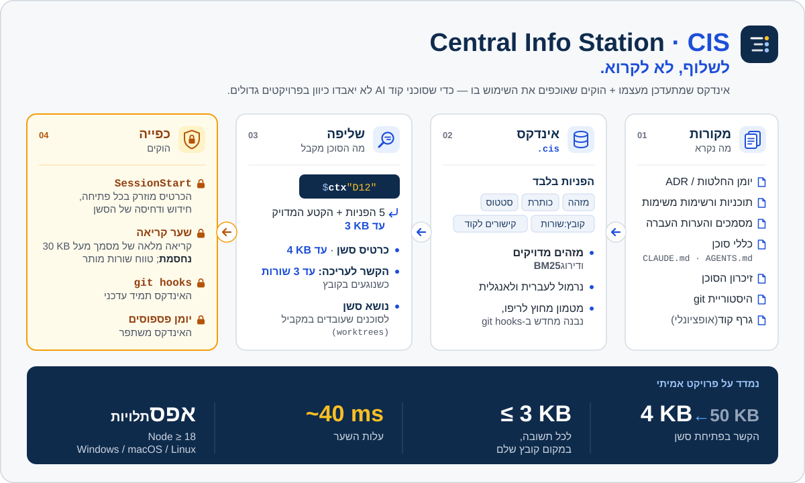

<div dir="rtl">

# Central Info Station (CIS)

> **נמדד על פרויקט אמיתי עם כמה סוכנים במקביל:**
>
> | | לפני | עם CIS | חיסכון |
> |---|---|---|---|
> | הקשר בפתיחת סשן | כ-50KB | **עד 4KB** | **כ-92%** |
> | שליפה אחת ("איפה החלטנו על X?") | מסמך שלם, 50–300KB | **עד 3KB** | **94–99%** |
> | עלות שער הקריאה לכל פעולה | — | **כ-40ms** | — |

**לשלוף, לא לקרוא.** אינדקס שמתעדכן מעצמו, של ההכרעות, התוכניות, נקודות ההמשך וכללי הסוכן בפרויקט. לצידו הוקים של Claude Code
שגורמים לסוכני קוד באמת **להשתמש** בו, במקום לשפוך מסמכים של 300KB להקשר.

[English](README.md)



## למה

בפרויקט גדול המסמכים גדלים מהר יותר ממה שסוכן מסוגל לקרוא: תוכנית של 200KB, יומן העברות של 300KB, טבלת הכרעות של 80 שורות,
וכללים שמפוזרים בכמה קובצי CLAUDE.md. סוכן שקורא את כל זה בשלמותו שורף את ההקשר שלו, ועדיין מפספס את השורה היחידה שחשובה.
הוא גם פותח מחדש הכרעות שנסגרו לפני שבועות, ומאבד את נקודת ההמשך בכל דחיסה. ההוראה "אל תקרא קבצים גדולים" מחזיקה רק עד הדחיסה הראשונה.

CIS משנה את ההרגל:

| | בלי | עם |
|---|---|---|
| התמצאות בפתיחת סשן | קריאת SESSION-CONTEXT וקובצי העברה (~50KB) | **כרטיס של עד 4KB** שמוזרק אוטומטית |
| "איפה החלטנו על X?" | פתיחה ודפדוף ביומן ההכרעות | `cis ctx "X"` ⇐ 5 הפניות + השורות המדויקות, **עד 3KB** |
| קריאת מסמך של 300KB "ליתר ביטחון" | מותרת | **חסומה** — קוראים את הטווח ש-ctx מצביע עליו |
| עריכת `billing.ts` | אין מושג שהכרעה חלה עליו | **עד 3 שורות**: ההכרעה / הכלל / הזיכרון שמזכירים אותו |
| שמירה על עדכניות | מישהו צריך לזכור | הוקי git בונים מחדש את האינדקס ברקע |

אין תלויות: Node 18 ומעלה, ב-Windows, ‏macOS ו-Linux.

## התקנה

ריפו אחד, שלוש דרכים להתקנה. בוחרים לפי הסביבה שלך. את הגרסה בודקים עם `claude --version`.

**Claude Code 2.1.275 ומעלה** — פקודה אחת:

<div dir="ltr">

```
/plugin install central-info-station --marketplace rordan-ai/central-info-station
```

</div>

**Claude Code ישן יותר עם פלאגינים** — שתי פקודות. הראשונה מוסיפה את הריפו כמקור לפלאגינים, והשנייה מתקינה ממנו. `rordan-ai` הוא שם המקור, לא כתובת נוספת:

<div dir="ltr">

```
/plugin marketplace add rordan-ai/central-info-station
/plugin install central-info-station@rordan-ai
```

</div>

**בלי מערכת פלאגינים** (או כשמעדיפים סקיל רגיל) — מעתיקים את תיקיית הסקיל:

<div dir="ltr">

```
git clone https://github.com/rordan-ai/central-info-station
cp -r central-info-station/plugins/central-info-station/skills/central-info-station ~/.claude/skills/
```

</div>

אחר כך, בתוך ריפו, מבקשים מ-Claude: *"תתקין CIS בריפו הזה"*. הסקיל עובר איתך על השלבים:

1. `cis init` מזהה את המקורות: כללי סוכן, ADR, יומני הכרעות, תוכניות משימות, מסמכים וקובצי נושא. הוא מציע `.cis/config.json`, ואתה עובר עליו.
2. `cis install` מעתיק את זמן הריצה אל `.cis/bin/`, ומוסיף שלושה הוקים ל-`.claude/settings.json` (ההוקים הקיימים שלך נשמרים). הוא גם מוסיף בלוק מסומן להוקי git ובונה את האינדקס.
3. `cis doctor` צריך להחזיר ✅ בכל שורה. הבדיקה כוללת הוכחה חיה שהשער חוסם קריאה מלאה ומתיר טווח שורות.
4. מכניסים ל-commit את `.cis/` ואת `.claude/settings.json`. מעכשיו כל שכפול, worktree, חבר צוות ו-CI מתנהגים אותו דבר.

## איך זה נראה

**כרטיס הפתיחה,** שמוזרק בכל פתיחה, חזרה לסשן או דחיסה:

<div dir="ltr">

```
🧭 כרטיס פתיחה · נושא: alpha · ענף agents/alpha @ 905bf6de
📌 פתוח בנושא (docs/sessions/alpha.md):
  - Finish 2.2 retries
↩️ נקודת המשך (כללית): Resume point 2026-04-10 — wip/retry-payments (2.2) — docs/HANDOFF.md:L9-12
🔴 קווים אדומים (מחולצים — המקור גובר):
  - 🔴 Never edit migrations after they ran … (CLAUDE.md:L4)
```

</div>

**שער הקריאה,** כשסוכן מנסה `cat docs/HANDOFF.md`:

<div dir="ltr">

```
🚫 שער הקריאה (CIS): docs/HANDOFF.md גדול — 31KB · 273 שורות. קריאה מלאה של הקובץ חסומה.
במקום: node .cis/bin/cis.js ctx "<נושא | מזהה | קובץ>" ⇐ קובץ:שורות מדויקים, ואז sed -n 'A,Bp' <קובץ>.
```

</div>

## מה הוא קורא

| סוג | דוגמאות |
|---|---|
| כללי סוכן | CLAUDE.md, ‏AGENTS.md, ‏GEMINI.md, ‏.cursorrules |
| הכרעות | טבלת הכרעות (`\| D12 \| … \|`), כותרות הכרעה, תיקיות ADR — כולל "הוחלף" ו"בוטל" |
| תוכניות | רשימות משימות `- [ ] **3.4** …` במצבים: פתוח, בביצוע, חסום, בוצע, בוטל |
| מסמכים | כל כותרת היא קטע. כותרת של "נקודת המשך" היא נקודת המשך; נקודות שנסגרו מדולגות |
| זיכרון | הזיכרון האוטומטי של Claude Code לפרויקט |
| git | קומיט שהנושא שלו מכיל מזהה מקשר את השורה לקבצים שהקומיט שינה |
| גרף קוד | אופציונלי: `graph.json` של graphify |

סוכנים שעובדים במקביל ב-git worktrees מקבלים כל אחד **נושא** משלו, עם קובץ markdown אחד לכל נושא. הנושא נקבע רק לפי הצהרה מפורשת, ולעולם לא לפי ניחוש.
עברית ואנגלית נתמכות במלואן: גם בנרמול החיפוש וגם בכל ההודעות (`"language": "he"`).

## כפייה, בבטחה

- ההוקים נרשמים לכל ריפו בנפרד, בצורת ה-exec המתועדת, ולצד ההוקים הקיימים שלך. `uninstall` מסיר בדיוק את מה שנוסף.
- כל הוק **נכשל פתוח**: שגיאה או timeout לעולם לא חוסמים פעולה. ‏`CIS_DISABLE=1` משתיק את כולם.
- השער חוסם רק מסמכים שהתחנה יודעת לשרת, כך שההודעה אף פעם לא מובילה למבוי סתום. ‏`gate.mode: "warn"` מסתפק בתזכורת.
- לסוכנים בלי הוקים (Codex, ‏Cursor, ‏Gemini CLI): ה-CLI עובד בכל מקום שיש בו Node, ו-`cis snippet` מחזיר את הכלל כטקסט ל-AGENTS.md.

## רישיון

MIT

</div>
