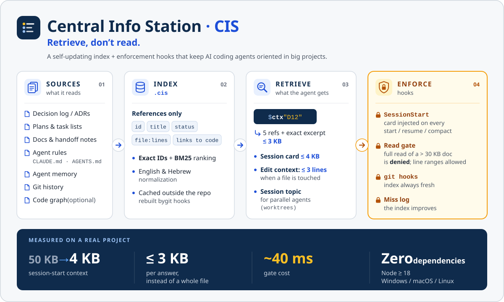

# Central Info Station (CIS)

**Retrieve, don't read.** A self-updating index of your project's decisions, plans, handoff notes and agent rules — plus
Claude Code hooks that make AI coding agents *use* it instead of pouring 300KB documents into their context.

[עברית](README.he.md)



## Why

Big projects grow documents faster than any agent can read them: a 200KB plan, a 300KB handoff log, an 80-row decision table,
rules spread over CLAUDE.md files. An agent that reads them whole burns its context, still misses the one line that matters,
re-opens decisions settled weeks ago, and loses the resume point at every compact. Telling it "don't read big files" lasts
until the first compact.

CIS changes the habit:

| | without | with |
|---|---|---|
| getting oriented at session start | read SESSION-CONTEXT / handoff files (~50KB) | a **≤4KB card** injected automatically |
| "where did we decide X?" | open and skim the decision log | `cis ctx "X"` ⇒ 5 refs + the exact lines, **≤3KB** |
| reading a 300KB doc "just in case" | allowed | **blocked** — read the range ctx points to |
| editing `billing.ts` | no idea a decision governs it | **≤3 lines**: the decision / rule / memory that names it |
| keeping it current | someone remembers to | git hooks rebuild the index in the background |

Measured on a real multi-agent project: session-start context **50KB → 4KB**, answers ≤3KB instead of whole files,
read-gate cost **~40ms** per tool call. Zero dependencies — Node 18+, Windows / macOS / Linux.

## Install

One repository, three ways in — pick by your setup (check your version with `claude --version`):

**Claude Code 2.1.275 or newer** — one command:

```
/plugin install central-info-station --marketplace rordan-ai/central-info-station
```

**Older Claude Code with plugins** — two commands (add this repo as a plugin source, then install from it;
`rordan-ai` is the source's name, not another address):

```
/plugin marketplace add rordan-ai/central-info-station
/plugin install central-info-station@rordan-ai
```

**No plugin system** (or you prefer a plain skill) — copy the skill folder:

```
git clone https://github.com/rordan-ai/central-info-station
cp -r central-info-station/plugins/central-info-station/skills/central-info-station ~/.claude/skills/
```

Then, in a repository, ask Claude: *"set up CIS in this repo"*. The skill walks through it with you:

1. `cis init` — detects your sources (agent rules, ADRs, decision logs, task plans, docs, topic files) and proposes
   `.cis/config.json`; you review it.
2. `cis install` — vendors the runtime to `.cis/bin/`, merges three hooks into `.claude/settings.json` (your
   existing hooks are kept), adds a marked block to your git hooks, builds the index.
3. `cis doctor` — every line ✅, including a live proof that the gate blocks a full read and allows a range.
4. Commit `.cis/` and `.claude/settings.json` — every clone, worktree, teammate and CI run behaves the same.

Without Claude: `node ~/.claude/skills/central-info-station/scripts/cis.js install` (after that, `node .cis/bin/cis.js …`).

## What it looks like

The card, injected at every start / resume / compact:

```
🧭 Session card · topic: alpha · branch agents/alpha @ 905bf6de
📇 index from 905bf6de (2026-10-26 08:51 UTC) · 80 rows · ✅ fresh
🌿 main 905bf6de · this branch vs main: behind 0 · ahead 0
📌 Open in this topic (docs/sessions/alpha.md):
  - Finish 2.2 retries
  plan: 3 open · ⛔ blocked: 2.3 — cis ctx "<id>" for details
↩️ Resume point (project): Resume point 2026-04-10 — wip/retry-payments (2.2) — docs/HANDOFF.md:L9-12
🔴 Red lines (extracted — the source wins):
  - 🔴 Never edit migrations after they ran — add a new migration instead (db/migrations/). (CLAUDE.md:L4)
🔎 Retrieve, don't read — cis = node .cis/bin/cis.js · cis ctx "<topic | id | file | symbol>"
```

A lookup — a superseded decision is shown with the one that replaced it:

```
$ cis ctx D2
1. [decision] D2 · Cache invoices for 1 hour · superseded by D5 · docs/DECISIONS.md:L6 (id)
2. [decision] D5 · No invoice cache — compute at runtime; supersedes D2 · active · docs/DECISIONS.md:L9 (replaces)
── excerpt (1) docs/DECISIONS.md:L6 ──
| D2 | Cache invoices for 1 hour | speed | 2026-02-01 |
```

The gate, when an agent tries `cat docs/HANDOFF.md`:

```
🚫 Read gate (CIS): docs/HANDOFF.md is large — 31KB · 273 lines. Reading the whole file is blocked.
Instead: node .cis/bin/cis.js ctx "<topic | id | file>" ⇒ exact file:lines, then sed -n 'A,Bp' <file> · head -n N <file>.
Line ranges are always allowed. Code files are never blocked.
```

Before an edit of `db/migrations/001_init.sql`:

```
🧭 CIS · rule Never edit migrations after they ran — add a new migration instead… (CLAUDE.md:L4)
```

## What it reads

| kind | examples |
|---|---|
| agent rules | CLAUDE.md, AGENTS.md, GEMINI.md, .cursorrules, copilot-instructions.md |
| decisions | a decision table (`\| D12 \| … \|`), decision headings, ADR folders (`0007-title.md`) — with supersede / cancel |
| plans | task lists `- [ ] **3.4** …` with open / in-progress / blocked / done / dropped |
| docs | every heading = a section; "resume point / next session / handoff" headings = resume points (closed ones are skipped) |
| memory | Claude Code's per-project auto-memory |
| git | commits whose subject carries an id link that row to the files they changed |
| code graph | optional — a graphify `graph.json` (nodes with `source_file`, import/call links): importers, tests and symbols for file queries |

Parallel agents in git worktrees get their own **topic** (one markdown file each), decided only by explicit declarations —
never by guessing. English and Hebrew are first-class (search normalization and all messages).

## Commands

`node .cis/bin/cis.js <command>`

| command | |
|---|---|
| `ctx "<query>"` | ≤5 references + the exact excerpt, ≤3KB (`--json` for scripts) |
| `card` | the session card |
| `miss "<query>" --expected "<file:line \| id>"` · `misses` | the improvement loop |
| `init` · `install` · `uninstall` · `doctor` | set up, enforce, remove, verify |
| `build` · `check` · `archive` | refresh · size caps · move old dated sections to monthly archives (dry run first) |
| `topic` · `snippet` | this tree's topic · a "retrieve, don't read" section for agents without hooks |

## Enforcement, safely

- Hooks are registered per repo, in the documented exec form (`"command": "node", "args": ["${CLAUDE_PROJECT_DIR}/…"]`), next
  to your existing hooks; `uninstall` removes exactly what was added.
- Every hook **fails open** — an error or timeout never blocks a tool call. `CIS_DISABLE=1` silences them.
- The gate only blocks documents CIS can serve, so the message is never a dead end. `gate.mode: "warn"` nudges instead.
- Agents without hooks (Codex, Cursor, Gemini CLI …): the CLI works anywhere Node runs; `cis snippet` gives the rule as text
  for AGENTS.md.

Details: [SKILL.md](plugins/central-info-station/skills/central-info-station/SKILL.md) ·
[config reference](plugins/central-info-station/skills/central-info-station/references/config.md) ·
[formats](plugins/central-info-station/skills/central-info-station/references/formats.md) ·
[enforcement](plugins/central-info-station/skills/central-info-station/references/enforcement.md)

## Development

```
npm test          # node --test — 22 tests on a generated sample repository (git required)
npm run demo      # creates ./demo-repo to try it on
```

## License

MIT
